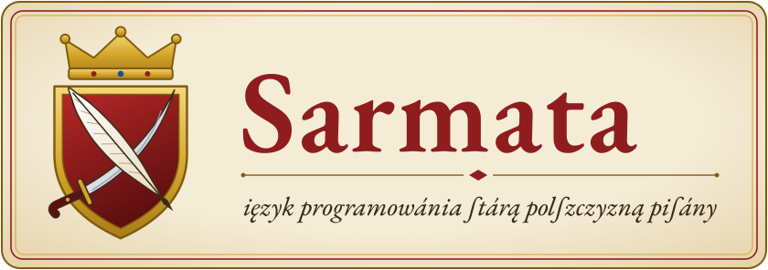

<p align="center">
  
</p>

# Sarmata

Język programowania pisany staropolszczyzną XVI wieku. Program czyta się jak kronikę,
a skryba (kompilator) przepisuje go na C i wykuwa z niego natywną binarkę.

```
Rozdział pierwszy, w którym liczymy do stu á wołamy, gdy przyſtoi.

Dla każdey liczby od iednego do stu:
    Ieſli liczba iest podzielna przez piętnaście, obwieść „FizzBuzz”,
    á ieſli podzielna przez trzy, obwieść „Fizz”,
    á ieſli podzielna przez pięć, obwieść „Buzz”,
    inaczey obwieść liczbę.

Amen.
```

## Jak tego używać

Potrzebny jest Rust (do zbudowania skryby) i kompilator C (`cc`, gcc albo clang).

```sh
cargo build --release
./target/release/sarmata przyklady/silnia.sar          # tworzy plik wykonywalny ./silnia
./target/release/sarmata przyklady/silnia.sar -o silnia
./target/release/sarmata uruchom przyklady/silnia.sar  # kompiluje i od razu uruchamia
./target/release/sarmata przekład przyklady/silnia.sar # C zdanie po zdaniu, z pismem w komentarzach
./target/release/sarmata c przyklady/silnia.sar        # cały wygenerowany kod C, z biegiem
./target/release/sarmata rozmowa                       # REPL: pisz zdania, skryba odpowiada
```

Kolorowanie składni dla VS Code leży w `edytory/vscode/` (skopiuj katalog do
`~/.vscode/extensions/sarmata`). Gramatykę wypisuje `sarmata gramatyka`.

Inny kompilator C wskazuje się zmienną `CC`. Testy: `cargo test` (przepuszcza każdy przykład
z `przyklady/` i porównuje wynik z plikiem `.oczekiwane`).

## Statut, czyli gramatyka

### Pisownia

Pisać można po staremu albo po nowemu, skrybie to jedno. Przed porównaniem każde słowo jest
sprowadzane do wspólnej postaci: `ſ`→s, `á`→a, `é`→e, `y`/`j`→i, `v`→u, a polskie litery
tracą ogonki. Zatem `Ieſli`, `Jeśli` i `ieśli` to jedno słowo, tak samo `niechay` i `niechaj`.

### Zdania i bloki

- Każde zdanie kończy się kropką (albo `!`, `?`, `;`). Zdanie może ciągnąć się przez wiele wierszy.
- Zdanie kończące się **dwukropkiem** i następujące po nim wcięcie tworzą blok.
- Kropka wewnątrz cudzysłowu na końcu wiersza (`Obwieść „Koniec.”`) też kończy zdanie.
- Program **musi** kończyć się słowem `Amen.`
- Kilka rozkazów można zmieścić w jednym zdaniu, łącząc je przecinkiem, „i”, „á potem”, „po czym”:
  `Zwiększ licznik, á potem obwieść licznik.`

### Przypisy (komentarze)

Wiersz zaczynający się od jednego ze słów: *Glossa, Przypis, Rozdział, Księga, Pieśń, Anno,
Przedmowa, Posłowie, Tytuł* jest przypisem. Przypis bez kropki na końcu ciągnie się dalej,
dopóki kolejne wiersze zaczynają się małą literą.

```
Przedmowa. Proiekt semestralny z przedmiotu „Podstawy programowania”,
spisany ku chwale Rzeczypospolitey.
```

### Słowa-wypełniacze

Skryba pomija słowa, które dodają tylko kolorytu: *tedy, wtedy, to, zatem, przeto, oto, się,
waść, co następuje, jako następuje* i podobne. `Obwieść tedy liczbę` znaczy `Obwieść liczbę`.

### Wartości

| Rodzaj | Jak zapisać |
|---|---|
| liczby | `5`, `dwieście trzydzieści pięć`, `MDLXXII` (rzymskie, wielkimi literami), w każdym przypadku: `pięciu`, `dwóch` |
| ułamki | `3,14`, `3.14`, `dwa i pół`, `pół`, `półtora` |
| pisma (napisy) | `„Witay”`, `"Witay"`, `«Witay»`; wstawki: `„Wynik: {silnia z n}”` |
| prawda i fałsz | `prawda`, `zaiste`, `fałsz`, `bynajmniej` |
| nic | `nic`, `nicość` |
| regestr (lista) | `regestr z pięciu, trzech i ośmiu`, `regestr pusty`, `regestr o długości trzech pełen zer` |

Liczby całkowite dzielone przez siebie dają liczbę całkowitą, gdy dzielą się bez reszty,
a w przeciwnym razie ułamek. Ułamki wypisuje się z przecinkiem: `4,75`.

### Miana (nazwy)

Miano może składać się z kilku słów (`największy wspólny dzielnik`, `pierwsza liczba`).
Skryba rozpoznaje je **po rdzeniu**, więc odmiana działa sama: `liczba`, `liczbę`, `liczby`,
`liczbą` to ta sama rzecz.

Zasady, o których trzeba pamiętać:
- Różne rzeczy muszą mieć różne rdzenie. `liczba` i `liczby` to dla skryby to samo miano.
- Najlepiej działają rzeczowniki odmieniające się regularnie. Odmiana z obocznościami
  (`imię`/`imienia`, `żak`/`żacy`) nie zostanie rozpoznana. Zamiast `imię` lepiej napisać `miano`.
- Słowa skryby (np. `i`, `pusty`, `nowy`, `element`) nie mogą być mianami. Skryba to wytknie.

### Rozkazy

```
Niechay liczba będzie pięć.              Niechay będzie liczba równa pięć.
Odtąd liczba iest sześć.                 Odtąd a iest b, á b iest reszta.
Zwiększ licznik.                         Zwiększ licznik o trzy.
Zmniejsz licznik o dwa.                  Pomnóż kapitał przez dwa.
Podziel tort przez osiem.                Odejmij dwa od skarbu.
Dodaj ocenę do ocen.                     (do regestru dokłada, do liczby dolicza)
Obwieść „Witay”, miano i wiek.           Obwieść „bez końca wiersza” nie kończąc wiersza.
Rzekł tedy rotmistrz, gładząc wąsa: „— Mości panowie!”     (narracja do dwukropka iest pomijana)
Zapytaj „Ile lat? ” o wiek.              (cały wiersz z wejścia; liczby same się rozpoznają)
Wczytaj liczbę.                          (jedno słowo z wejścia)
Posortuj liczby.                         Posortuj żaki według średniey malejąco.
Usuń ostatni element z listy.            Usuń element trzy z listy.
Zapisz raport do pliku „raport.txt”.     Dopisz wiersz do pliku „dziennik.txt”.
```

### Warunki

```
Ieśli liczba iest większa niż dziesięć, obwieść „dużo”.

Ieśli wiek iest mnieyszy niż osiemnaście:
    Obwieść „Za młody”.
A ieśli wiek iest większy albo równy sześćdziesiąt:
    Obwieść „Senior”.
Inaczey obwieść „W sam raz”.
```

„A ieśli” można też zapisać `Azali`, a „inaczey” jako `w przeciwnym razie`.
Podmiot da się pominąć, jeśli jest ten sam co w pierwszym warunku:
`á ieśli podzielna przez trzy, …`.

**Porównania:** `iest równy`, `iest`, `nie iest`, `iest różny od`, `iest większy niż/od`,
`iest mnieyszy niż`, `większy albo równy`, `przewyższa`, `iest co naymniey`, `iest co naywyżey`,
`iest podzielny przez`, `iest parzysty`, `nieparzysty`, `dodatni`, `ujemny`, `pusty`,
`zawiera`, `iest w`. Do tego znaki `= != < > <= >=`.
**Spójniki:** `i`, `oraz`, `albo`, `lub`, `nie`.

### Pętle

```
Dla każdego n od iednego do dziesięciu: …
Dla każdego k od dziesięciu do iednego co minus trzy: …
Dla każdego żaka z żaków: …
Póki dzielnik nie iest równy zeru, czyń: …
Powtórz trzy razy: …
Zawsze czyń: …          (albo: Bez końca czyń: …)
Przerwij.   Pomiń.
```

Gdy obie granice są stałymi liczbami („od dziesięciu do iednego”), pętla sama wybiera kierunek.
W każdym innym razie krok wynosi +1, a pętla „od 1 do 0” nie wykona się ani razu.

### Działania

`plus`/`dodać`, `minus`/`bez`, `razy`, `podzielone przez`, `modulo`,
`reszta z dzielenia a przez b`, `do potęgi`, `do kwadratu`, `do sześcianu`, `wspak`.
Znaki `+ - * / ( )` też działają.

### Regestry i pisma

```
element trzy z ocen       pierwszy element ocen      ostatni element ocen
długość ocen              oceny wspak                „Kraków” czytane wspak
Odtąd drugi element ocen iest pięć.
```

Liczy się **od jedynki**, „iáko Pan Bóg przykazał”. Pisma indeksuje się po literach (UTF-8).

### Uczynki (funkcje)

```
Uczynek silnia, przyimuiący liczbę:
    Ieśli liczba iest mnieysza niż dwa, oddaj ieden.
    Oddaj liczbę razy silnię z liczby bez iednego.

Obwieść silnię z pięciu.
Obwieść największy wspólny dzielnik z czterdziestu i sześćdziesięciu.
Uczyń przywitanie gościa z „Jana”.
```

Uczynek woła się po mianie, w dowolnym przypadku, z przyimkiem (`z`, `dla`, `od`, `o`, `na`)
albo bez niego. Kolejne rzeczy oddziela się przecinkiem albo „i”. Uczynki można spisać
w dowolnym miejscu programu, także po wywołaniu.

**Wbudowane:** `pierwiastek`, `wartość bezwzględna`, `zaokrąglenie`, `część całkowita`,
`wartość liczbowa`, `losowa liczba od a do b`, `wielkie litery`, `małe litery`,
`rozbiór` (dzieli pismo na słowa), `rozcięcie x przez „;”` (tnie po znaku), `treść pliku`, `wiersze pliku`, `największy`,
`najmniejszy`, `kopia`, `złączenie x przez „, ”`, `rodzaj`, `klucze z`, `wartości z`,
`zawartość katalogu`, `słowa wywołania`.

### Spisy (słowniki)

```
Niechay ceny będą spisem, gdzie „chleb” ma trzy, „miód” ma pięć, a „wino” ma dwanaście.
Obwieść ceny pod „miód”.
Zwiększ ceny pod „sól” o ieden.             (brakujący klucz zaczyna od zera)
Ieśli ceny maią „wino”, usuń „wino” z cen.
Obwieść klucze z cen, wartości z cen.
```

### Regestry składane

```
Niechay kwadraty będą x razy x dla każdego x od iednego do dziesięciu.
Niechay duże będą wszystkie liczby, które są większe niż cztery.
Niechay mądrzy będą wszyscy z żaków, których średnia iest większa niż cztery.
```

### Próby i klątwy (wyjątki)

```
Spróbuy:
    Obwieść dzielenie z dziesięciu i zera.
A w razie biedy, zwaney nieszczęściem:
    Obwieść „Biada! Rzekli:”, nieszczęście.

Rzuć klątwę „Przez zero dzielić nie przystoi.”
```

Próba łapie klątwy rzucone przez `Rzuć` i grzechy biegu (dzielenie przez zero, element
poza regestrem…). Klątwa niezłapana kończy program: *„Klątwá nie zdięta: …”*.

### Rodzaje, liczby rzymskie i słowne

```
Ieśli x iest liczbą całkowitą: …            (też: pismem, regestrem, spisem, Żakiem…)
Obwieść „Anno {rok rzymskimi}”.              → Anno MDCX
Obwieść suma słownie.                        → dwá tyśiące dwádźieśćiá ſześć
```

### Pliki, wywołanie, koniec

```
Ieśli plik „raport.txt” istnieie, usuń plik „raport.txt”.
Utwórz katalog „kronika”.
Przenieś plik „a.txt” do „kronika/a.txt”.
Obwieść zawartość katalogu „kronika”, słowa wywołania.
Zakończ z kodem trzy.
```

### Rody (struktury)

```
Ród Żak ma miano, nazwisko, stopnie i średnią.

Niechay student będzie nowym Żakiem o mianie „Jan”, nazwisku „Kochanowski”
    i średniey równey pięć.
Obwieść miano studenta.
Odtąd średnia studenta iest cztery.
```

Pole czyta się, stawiając jego miano przed rzeczą: `nazwisko żaka`, `średnia studenta`.

### Księgi (wiele plików)

```
Powołując się na „żacy.sar”.
```

Księga to plik z samymi uczynkami i rodami, zakończony `Amen.` Powołana, działa tak,
jakby jej treść spisano w piśmie głównym. Ścieżka liczy się od pliku powołującego,
`.sar` wolno pominąć, a błędne koło powołań skryba wytknie.

## Grzechy (błędy)

Skryba wytyka błędy po staropolsku i wskazuje miejsce:

```
Grzech śmiertelny w „silnia.sar”, wierſz 2:
 2 │ Obwieść liczbę plus dukaty.
   │                     ^^^^^^
Słowo „dukaty” obce ieſt ſkrybie. Nie ochrzcono go przez «Niechay będźie …» ani nie ieſt to vczynek.
```

Błędy w trakcie działania też mają swoje kazania:
*„Elementu zerowego nie mász — liczymy od iednego, iáko Pan Bóg przykazał.”*

## Przykłady

| Plik | Co czyni |
|---|---|
| `przyklady/witay.sar` | Witay, świecie |
| `przyklady/silnia.sar` | silnia, rekurencja |
| `przyklady/fizzbuzz.sar` | FizzBuzz |
| `przyklady/nwd.sar` | algorytm Euklidesa |
| `przyklady/pierwsze.sar` | liczby pierwsze do stu |
| `przyklady/palindrom.sar` | wczytywanie i pisma wspak |
| `przyklady/sortowanie.sar` | sortowanie bąbelkowe |
| `przyklady/karczma.sar` | kronika karczmy: spis cen, klątwy za niezapłacone trunki, regestry składane, plik z długami |
| `przyklady/baszta.sar` | opowieść o oblężonej baszcie; pod spodem problem Józefa Flawiusza i racjonowanie chleba |
| `przyklady/dziennik/dziennik.sar` | projekt semestralny: dziennik ocen z menu, plikiem, rodem i rankingiem; ród i uczynki w księdze `żacy.sar` |

## Budowa skryby

`src/lexer.rs` (słowa i wcięcia) → `src/powolania.rs` (wplata powołane księgi) → `src/parser.rs` (zdania, miana po rdzeniach) →
`src/codegen.rs` (C) + `runtime/sarmata.c` (bieg: wartości dynamiczne, regestry, spisy, rody,
próby na `setjmp`/`longjmp`) → `cc`. `src/gramatyka.rs` wywodzi ze słownika gramatykę dla edytorów.
Pamięci się nie zwalnia, albowiem szlachta ziemi raz zdobytej nie oddaje.
